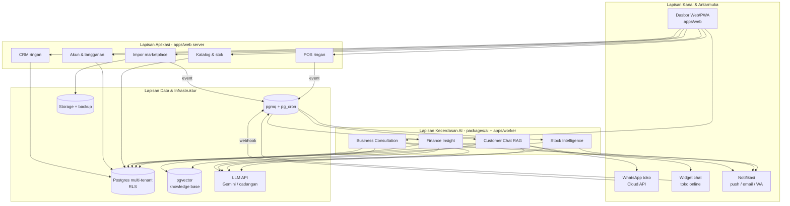
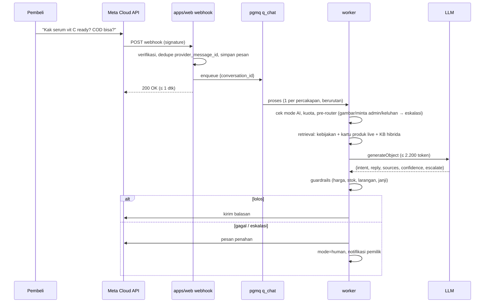

# TECH-SPEC — WADAR AI (Fase 1)
### Realisasi teknis PRD v2: stack, skema data, rumus mesin AI, pipeline RAG, WhatsApp, biaya, keamanan, dan milestone build

| Meta | Isi |
|---|---|
| Versi | 2.0 — 14 Oktober 2026 |
| Menggantikan | `ARCHITECTURE.md` v1 dan `BUILD-PLAN.md` v1 |
| Prinsip | Sesuai proposal: **4 lapis, 4 mesin AI, 1 knowledge base per toko, LLM bisa diganti**. Stack dipilih supaya **1 engineer + Claude Code** bisa mencapai pilot Januari 2027 |
| Status keputusan | Default di dokumen ini berlaku sampai dijawab lain di §15 |

**Kenapa lebih sederhana dari v1:** proposal menargetkan 1 engineer di 2027 dan pilot dalam ±12 minggu. v1 (NestJS + Redis/BullMQ + outbox + Expo + 14 modul) terlalu berat untuk itu. v2 memakai **Next.js + Supabase + satu worker**, dengan batas modul tetap rapi supaya bisa dipecah nanti.

---

## 0. Ringkasan Stack (default)

| Lapis proposal | Komponen | Teknologi |
|---|---|---|
| Kanal & antarmuka | Dasbor PWA, widget chat, struk publik | **Next.js (App Router) + TypeScript + Tailwind + shadcn/ui**, Serwist (PWA), Web Push (VAPID) |
| | WhatsApp | **WhatsApp Cloud API** (Meta Graph API), Embedded Signup **v4** |
| | Notifikasi | Web Push, email (Resend), WA template utility |
| Aplikasi | POS, CRM, Katalog & Stok, Akun & Langganan | Server Actions + Route Handlers di Next.js; logika domain di `packages/core` |
| Kecerdasan AI | 4 mesin AI | **Vercel AI SDK** (`ai`, `@ai-sdk/google`), Zod untuk output terstruktur; rumus deterministik di `packages/core` |
| Data & infrastruktur | DB transaksi multi-tenant | **Supabase Postgres** + Row Level Security |
| | Vector DB | **pgvector** (HNSW) + `tsvector` + `pg_trgm` di Postgres yang sama |
| | Antrean & jadwal | **Supabase Queues (pgmq)** + **pg_cron** |
| | Worker | **Node.js (TypeScript) di Railway**: konsumen antrean, AI chat, ingest KB, impor |
| | LLM API | Gemini 3.1 Flash-Lite (utama), Gemini 3 Flash (analisis); penyedia cadangan lewat abstraksi |
| | File | Supabase Storage (bucket privat per tenant) |
| | Auth | Supabase Auth (email OTP/magic link + Google) |
| | Pembayaran langganan | Xendit Invoice (VA + QRIS) |
| | Hosting | Vercel (web), Railway (worker), Supabase (DB) |
| | Observability | Sentry, PostHog, tabel `ai_runs` |

> Versi pustaka & nama model: Claude Code **wajib** memeriksa versi stabil terbaru dan nama model aktif sebelum memasang. Harga acuan per Oktober 2026: Gemini 3.1 Flash-Lite US$0,25/US$1,50 (input/output per 1 juta token, cached input US$0,025); Gemini 3 Flash US$0,50/US$3,00.

---

## 1. Arsitektur Empat Lapis → Komponen



**Prinsip arus data:** transaksi (POS/impor) → tabel transaksi → event di antrean → mesin deterministik menghitung angka (stok, margin) → LLM **hanya menarasikan** angka yang sudah dihitung, atau menjawab dengan data hasil fungsi baca. LLM tidak pernah menghitung uang dan tidak pernah meng-query database langsung.

---

## 2. Struktur Repository

```
wadar/
├─ apps/
│  ├─ web/                    # Next.js: UI, server actions, route handlers, webhook, widget
│  │  ├─ app/(auth)/ app/(app)/[tenant]/... app/api/... app/w/[slug]/ (widget publik) app/r/[token]/ (struk)
│  │  └─ modules/             # UI + server action per modul (tipis, memanggil packages/core & db)
│  └─ worker/                 # Node: konsumen pgmq, cron handler, pipeline AI chat, ingest KB, impor
├─ packages/
│  ├─ core/                   # LOGIKA BISNIS MURNI (tanpa I/O): uang, stok, finance, kuota, terbilang
│  │  ├─ money.ts  stock/  finance/  entitlements.ts  phone.ts
│  ├─ db/                     # skema & migrasi SQL (supabase/migrations), tipe hasil generate, repository tenant-scoped
│  ├─ ai/                     # provider abstraction, router model, prompt berversi, guardrails, tools, metering biaya
│  ├─ importers/              # parser file marketplace berversi + fixtures
│  ├─ whatsapp/               # klien Cloud API, verifikasi signature, template
│  ├─ brand/                  # nama, warna, logo, copy — rebrand hanya di sini
│  └─ config/                 # eslint, tsconfig, tailwind preset
├─ evals/                     # golden set + runner (chat, consult, red-team)
├─ supabase/                  # config.toml, migrations/, seed.sql
├─ docs/                      # BRD.md, PRD.md, TECH-SPEC.md, COMPETITORS.md, adr/
└─ CLAUDE.md
```

**Aturan dependensi** (ditegakkan dependency-cruiser):
- `packages/core` tidak mengimpor apa pun selain dirinya (fungsi murni, mudah dites).
- `packages/ai` boleh mengimpor `core`, `db`; **tidak** boleh dipanggil dari komponen klien.
- `apps/web` & `apps/worker` merangkai; logika bisnis tidak ditulis di komponen React.
- Akses DB dengan service role **hanya** lewat `packages/db/tenantRepo(tenantId)` yang menyuntikkan filter `tenant_id`.

---

## 3. Prinsip Teknis Wajib

1. **Uang = `bigint` rupiah.** Persentase disimpan sebagai `numeric(6,3)`. Pembagian uang memakai alokasi sisa terbesar (largest remainder) agar total tidak bergeser.
2. **Transaksi append-only.** `sales`, `stock_movements`, `expenses` tidak di-UPDATE nominalnya; koreksi = void + entri baru. Hanya `status` yang berubah, dan setiap perubahan tercatat di `audit_logs`.
3. **Idempotensi.** Setiap POST pembuat transaksi membawa `idempotency_key` (UUIDv7 dari klien) dengan constraint unik. Webhook dideduplikasi lewat ID dari penyedia.
4. **Multi-tenant ganda:** RLS di semua tabel tenant + filter eksplisit di repository + tes isolasi otomatis.
5. **AI read-only di Fase 1** (BRL-13). Tool AI hanya membaca dari view/fungsi yang disediakan.
6. **Angka dulu, narasi kemudian.** Semua angka dihitung di `packages/core`/SQL. LLM menerima angka jadi (termasuk selisih & persen yang sudah dihitung).
7. **Biaya terukur.** Setiap panggilan LLM melewati `packages/ai/meter` dan tercatat di `ai_runs` dengan biaya rupiah.

---

## 4. Model Data (Postgres)

Konvensi: `id uuid default gen_uuid_v7()` (atau `uuid_generate_v7()` bila tersedia; jika tidak, buat di aplikasi), `tenant_id uuid not null`, `created_at timestamptz default now()`. Semua tabel tenant memakai RLS template §4.3.

### 4.1 Inti
```sql
-- Identitas & tenant
create table tenants (
  id uuid primary key, name text not null, slug text unique not null,
  business_type text, timezone text not null default 'Asia/Jakarta',
  partner_id uuid null,                 -- B2B2B (BR-19), Fase 3
  is_demo boolean not null default false, created_at timestamptz default now()
);
create type member_role as enum ('owner','cashier','chat_admin');
create table memberships (
  tenant_id uuid references tenants, user_id uuid references auth.users,
  role member_role not null, primary key (tenant_id, user_id)
);
create table internal_staff (user_id uuid primary key, role text check (role in ('admin','cs','ai_trainer')));

-- Kanal & komisi
create type channel_kind as enum ('pos','manual','whatsapp','instagram','shopee','tiktok_shop',
  'tokopedia','gofood','grabfood','shopeefood','website','other');
create table channels (
  id uuid primary key, tenant_id uuid not null, kind channel_kind not null, name text not null,
  fee_pct numeric(6,3) not null default 0, fee_fixed bigint not null default 0,
  fee_is_default boolean not null default true, is_active boolean default true
);

-- Katalog
create table products (
  id uuid primary key, tenant_id uuid not null, name text not null, category text,
  description text, unit text default 'pcs', image_path text, is_active boolean default true,
  deleted_at timestamptz
);
create table variants (
  id uuid primary key, tenant_id uuid not null, product_id uuid not null references products,
  sku text, barcode text, option_label text,          -- "Merah / L"
  price bigint not null, avg_cost bigint not null default 0, cost_is_set boolean not null default false,
  min_stock int not null default 0, lead_time_days int not null default 3, pack_size int not null default 1,
  track_expiry boolean not null default false,
  on_hand int not null default 0,                     -- proyeksi dari stock_movements (diupdate di transaksi yang sama)
  unique (tenant_id, sku)
);
create table channel_prices (variant_id uuid references variants, channel_id uuid references channels,
  tenant_id uuid not null, price bigint not null, primary key (variant_id, channel_id));

-- Stok
create type movement_kind as enum ('purchase','sale','adjustment','return','void','opname','import');
create table stock_movements (
  id uuid primary key, tenant_id uuid not null, variant_id uuid not null references variants,
  qty int not null,                                   -- bertanda: + masuk, - keluar
  kind movement_kind not null, unit_cost bigint, expiry_date date,
  ref_type text, ref_id uuid, occurred_at timestamptz not null, created_by uuid
);
create table stock_daily (                            -- rollup malam untuk laju jual & deteksi hari stockout
  tenant_id uuid not null, variant_id uuid not null, day date not null,
  opening int not null, sold int not null, closing int not null, primary key (variant_id, day)
);
create table stock_forecasts (
  variant_id uuid primary key, tenant_id uuid not null, velocity numeric(10,3), sigma numeric(10,3),
  days_left numeric(8,1), stockout_date date, reorder_point int, reorder_qty int,
  status text check (status in ('habis','kritis','menipis','aman','tidak_aktif')),
  slow_moving boolean, idle_capital bigint, computed_at timestamptz
);

-- Pelanggan
create table customers (
  id uuid primary key, tenant_id uuid not null, name text, phone_e164 text, marketplace_handle text,
  first_channel channel_kind, notes text, tags text[] default '{}',
  total_spent bigint default 0, orders_count int default 0, last_order_at timestamptz,
  unique (tenant_id, phone_e164)
);

-- Penjualan
create type sale_source as enum ('pos','manual','import');
create type sale_status as enum ('completed','void','canceled','returned');
create table sales (
  id uuid primary key, tenant_id uuid not null, channel_id uuid not null references channels,
  source sale_source not null, external_order_id text, customer_id uuid references customers,
  status sale_status not null default 'completed',
  subtotal bigint not null, order_discount bigint not null default 0,
  shipping_subsidy bigint not null default 0,         -- ongkir yang ditanggung penjual
  platform_fee bigint not null default 0, platform_fee_estimated boolean not null default false,
  total bigint not null, payment_method text, occurred_at timestamptz not null,
  idempotency_key text, created_by uuid,
  unique (tenant_id, channel_id, external_order_id), unique (tenant_id, idempotency_key)
);
create table sale_items (
  id uuid primary key, tenant_id uuid not null, sale_id uuid not null references sales,
  variant_id uuid references variants, name_snapshot text not null,
  qty int not null, unit_price bigint not null, line_discount bigint not null default 0,
  unit_cost_snapshot bigint not null,                 -- avg_cost saat transaksi
  alloc_order_discount bigint not null default 0, alloc_platform_fee bigint not null default 0,
  alloc_shipping_subsidy bigint not null default 0
);

-- Keuangan
create table expenses (id uuid primary key, tenant_id uuid not null, category text not null,
  amount bigint not null check (amount > 0), occurred_at date not null, note text, receipt_path text,
  idempotency_key text, unique (tenant_id, idempotency_key));

-- Impor
create table import_jobs (id uuid primary key, tenant_id uuid not null, marketplace channel_kind,
  file_path text, parser_id text, status text, stats jsonb, errors jsonb, created_at timestamptz default now());
create table sku_mappings (tenant_id uuid not null, channel_id uuid not null, external_sku text,
  external_name text, variant_id uuid references variants, primary key (tenant_id, channel_id, external_sku, external_name));
```

### 4.2 AI, chat, langganan, operasional
```sql
create table store_profile (
  tenant_id uuid primary key, policies jsonb not null default '{}',   -- divalidasi Zod: StorePolicies
  persona jsonb not null default '{}', kb_version int not null default 1, catalog_version int not null default 1
);
create table kb_documents (id uuid primary key, tenant_id uuid not null,
  kind text check (kind in ('doc','faq','catalog','policy')), title text, source_path text,
  status text check (status in ('processing','ready','failed')), checksum text, created_at timestamptz default now());
create table kb_chunks (id uuid primary key, tenant_id uuid not null, document_id uuid references kb_documents on delete cascade,
  content text not null, tokens int, embedding vector(768),
  tsv tsvector generated always as (to_tsvector('simple', content)) stored, metadata jsonb);
create index on kb_chunks using hnsw (embedding vector_cosine_ops);
create index on kb_chunks using gin (tsv);
create index on products using gin (name gin_trgm_ops);

create table memory_items (id uuid primary key, tenant_id uuid not null,
  kind text check (kind in ('preference','fact','decision')), content text not null,
  source text, pinned boolean default true, created_at timestamptz default now());

create table wa_accounts (tenant_id uuid primary key, waba_id text, phone_number_id text unique,
  display_phone text, access_token_enc bytea, coexistence boolean default false, status text);
create table conversations (id uuid primary key, tenant_id uuid not null,
  channel text check (channel in ('whatsapp','widget')), customer_id uuid, external_user_id text,
  mode text not null default 'ai' check (mode in ('ai','human')),
  status text not null default 'open' check (status in ('open','escalated','closed')),
  escalation_reason text, last_inbound_at timestamptz, window_expires_at timestamptz,
  unique (tenant_id, channel, external_user_id));
create table messages (id uuid primary key, tenant_id uuid not null, conversation_id uuid references conversations,
  direction text check (direction in ('in','out')), author text check (author in ('customer','ai','human','system')),
  content text, media jsonb, provider_message_id text unique, ai_run_id uuid, created_at timestamptz default now());
create table chat_sessions (tenant_id uuid not null, conversation_id uuid not null,
  window_started_at timestamptz not null, primary key (conversation_id, window_started_at));  -- meter "percakapan" BRL-03

create table consult_threads (id uuid primary key, tenant_id uuid not null, user_id uuid, title text, created_at timestamptz default now());
create table consult_messages (id uuid primary key, tenant_id uuid not null, thread_id uuid references consult_threads,
  role text, content text, tool_calls jsonb, ai_run_id uuid, created_at timestamptz default now());

create table insights (id uuid primary key, tenant_id uuid not null,
  engine text check (engine in ('stock','finance','chat','consult')), type text, severity smallint,
  title text, body text, evidence jsonb not null, dedupe_key text,
  status text default 'new' check (status in ('new','seen','acted','dismissed')),
  period_start date, created_at timestamptz default now(), unique (tenant_id, dedupe_key));

create table ai_runs (id uuid primary key, tenant_id uuid, feature text, model text,
  input_tokens int, cached_tokens int, output_tokens int, cost_idr numeric(12,2),
  latency_ms int, guardrail jsonb, error text, created_at timestamptz default now());
create table answer_reviews (id uuid primary key, tenant_id uuid not null, message_id uuid references messages,
  reviewer_id uuid, verdict text check (verdict in ('correct','incorrect','unsafe')), note text, correction text,
  created_at timestamptz default now(), unique (message_id));

create table plans (code text primary key, price_monthly bigint, limits jsonb);  -- seed dari BRD §8.1
create table subscriptions (tenant_id uuid primary key, plan_code text references plans,
  period text check (period in ('monthly','annual')),
  status text check (status in ('trialing','active','past_due','read_only','canceled')),
  trial_ends_at timestamptz, current_period_end timestamptz, early_adopter boolean default false);
create table usage_counters (tenant_id uuid, period_start date,
  meter text check (meter in ('chat_conversations','consult_questions','wa_utility')),
  used int default 0, limit_value int, primary key (tenant_id, period_start, meter));
create table invoices (id uuid primary key, tenant_id uuid, amount bigint, ppn_amount bigint default 0,
  status text, gateway text, gateway_ref text unique, paid_at timestamptz, created_at timestamptz default now());
create table coupons (code text primary key, kind text, value jsonb, max_redemptions int, redeemed int default 0);
create table referrals (id uuid primary key, referrer_tenant uuid, referred_tenant uuid unique,
  status text, credited_at timestamptz);

create table audit_logs (id uuid primary key, tenant_id uuid, actor_id uuid, action text, target text,
  data jsonb, created_at timestamptz default now());
create table push_subscriptions (id uuid primary key, tenant_id uuid, user_id uuid, endpoint text unique, keys jsonb);
create table notifications (id uuid primary key, tenant_id uuid, user_id uuid, kind text, title text, body text,
  url text, read_at timestamptz, created_at timestamptz default now());
create table partners (id uuid primary key, name text);   -- stub B2B2B
```

### 4.3 RLS template
```sql
create or replace function app.is_member(t uuid) returns boolean
language sql stable security definer set search_path = '' as $$
  select exists (select 1 from public.memberships m where m.tenant_id = t and m.user_id = (select auth.uid()))
$$;
-- Untuk setiap tabel tenant X:
alter table X enable row level security;
create policy tenant_rw on X for all to authenticated
  using (app.is_member(tenant_id)) with check (app.is_member(tenant_id));
-- Tabel sensitif (expenses, insights finance, consult_*): tambahkan cek peran owner.
```
- Klien browser **tidak pernah** memegang service role key.
- Worker memakai service role, jadi wajib lewat `tenantRepo(tenantId)`. Tes memastikan setiap query repository memuat `tenant_id`.

### 4.4 View publik untuk Customer Chat (pertahanan "by construction")
```sql
create view chat_product_cards with (security_invoker = on) as
select v.id as variant_id, v.tenant_id, p.name, v.option_label, p.category, p.description,
       coalesce(cp.price, v.price) as price,          -- harga kanal WA jika ada
       case when v.on_hand <= 0 then 'habis'
            when v.on_hand <= 5 then 'sisa_sedikit' else 'tersedia' end as availability,
       least(v.on_hand, 5) as qty_hint                -- tidak membuka stok sebenarnya > 5
from variants v join products p on p.id = v.product_id
left join channel_prices cp on cp.variant_id = v.id
  and cp.channel_id = (select id from channels c where c.tenant_id = v.tenant_id and c.kind = 'whatsapp' limit 1)
where p.is_active and p.deleted_at is null;
-- TIDAK ada kolom avg_cost / margin. Tool customer chat hanya boleh membaca view ini.
```

---

## 5. Permukaan API

| Jenis | Endpoint / aksi | Catatan |
|---|---|---|
| Server Actions (UI) | `createProduct`, `importProducts`, `recordSale`, `voidSale`, `recordExpense`, `startMarketplaceImport`, `confirmSkuMapping`, `updatePolicies`, `uploadKbDoc`, `inviteMember`, `takeOverConversation`, `returnToAi`, `sendManualReply`, `answerUnanswered` | Validasi Zod dari `packages/core/schemas`; cek peran |
| Route handler | `GET/POST /api/webhooks/whatsapp` | Verifikasi token (GET) + `X-Hub-Signature-256` (POST); balas 200 ≤ 1 dtk; insert + enqueue |
| | `POST /api/webhooks/xendit` | Verifikasi `x-callback-token`; idempoten by `gateway_ref` |
| | `POST /api/consult` | Streaming (AI SDK `streamText`) dengan tools; auth pemilik |
| | `POST /api/widget/[slug]/messages`, `GET /api/widget/[slug]/stream` | Publik dengan rate limit per IP + sesi anonim; SSE untuk balasan |
| | `GET /r/[token]` | Struk publik (token bertanda tangan HMAC) |
| | `POST /api/sync/push` (P1) | Batch mutasi POS offline, idempoten |
| | `GET /api/export` | Ekspor data tenant (job → link unduh) |
| Worker | Konsumen antrean §10 | Tidak terbuka ke internet kecuali health check |

---

## 6. Lapisan AI Platform (`packages/ai`)

### 6.1 Abstraksi penyedia & routing (BR-10)
```ts
type Task = 'chat_reply' | 'intent' | 'narrate' | 'consult_fast' | 'consult_deep' | 'embed' | 'judge';
const ROUTES: Record<Task, ModelRef[]> = {          // urutan = fallback
  chat_reply:   ['google:gemini-3.1-flash-lite', 'fallback:light'],
  intent:       ['google:gemini-3.1-flash-lite'],
  narrate:      ['google:gemini-3.1-flash-lite'],
  consult_fast: ['google:gemini-3.1-flash-lite', 'fallback:light'],
  consult_deep: ['google:gemini-3-flash', 'fallback:mid'],
  embed:        ['google:gemini-embedding (768 dim)'],
  judge:        ['google:gemini-3-flash'],          // evals saja
};
```
- Fitur hanya memanggil `ai.run(task, input)`, tidak pernah SDK penyedia langsung.
- Model **thinking/reasoning diset minimal** untuk `chat_reply`, `intent`, dan `narrate`, karena token berpikir ditagih sebagai output.
- Circuit breaker per penyedia: 5 gagal/60 dtk → pindah ke fallback 30 dtk.

### 6.2 Anggaran token (diturunkan dari BRD §9)

| Tugas | Input maks | Output maks | Catatan |
|---|---|---|---|
| `chat_reply` | **2.200** (target ±1.800) | 220 | System + persona ±350 (dicache), kebijakan ±300, kartu produk top-5 ±400, potongan KB top-3 ±600, 6 giliran terakhir ±300 |
| `consult_fast` | 3.000 rata-rata (maks 6.000 dengan hasil tool) | 400 | Snapshot bisnis ≤ 600 token selalu disertakan |
| `consult_deep` | 6.000 | 700 | ≤ 20% panggilan konsultasi per tenant per bulan |
| `narrate` (insight) | 800 | 150 | Bahan = JSON evidence |

**Cek kewajaran biaya (Growth):** 1.050 balasan × (2.000 in, 150 out) + 90 konsultasi/job × (3.000 in, 400 out) ≈ 2,37 jt in / 0,19 jt out ≈ **US$0,88** ≈ Rp21 rb setelah kurs Rp18.000 × PPN 1,11 × buffer 1,2. Ini sedikit di atas anggaran Rp19.924 (±6%). Karena itu cache system prompt (`cached input` 10× lebih murah) **wajib** agar tetap di bawah anggaran.

### 6.3 Meter biaya
```ts
cost_idr = ((in - cached) * P_in + cached * P_cached + out * P_out) / 1e6 * KURS(18000) * 1.11 * 1.2
```
- Disimpan per panggilan di `ai_runs`. Job harian menjumlah per tenant → bandingkan dengan anggaran paket → `insights` internal + alert ADM bila rata-rata 7 hari > 120%.
- Harga per model disimpan di `packages/ai/pricing.ts` (satu tempat).

### 6.4 Caching
| Cache | Kunci | TTL | Kapan dipakai |
|---|---|---|---|
| Prompt caching penyedia | System prompt + persona + kebijakan per tenant | Sesuai penyedia | Semua `chat_reply` |
| Jawaban FAQ | `sha256(tenant, pertanyaan_ternormalisasi, kb_version, catalog_version)` | 24 jam | Hanya intent kebijakan/umum. **Tidak** untuk harga/stok |
| Insight harian Beranda | `tenant + tanggal` | 1 hari | CON-5 |
| Snapshot bisnis | `tenant` | invalidasi saat ada transaksi | Konsultasi |

---

## 7. Spesifikasi Empat Mesin AI

### 7.1 AI Stock Intelligence (`packages/core/stock`)
Dijalankan **inkremental** setelah transaksi/impor (antrean `q_stock_recompute`, per varian) dan **penuh** tiap malam 01.00 waktu toko.

**Input:** `stock_daily` 56 hari terakhir, `on_hand`, `lead_time_days (L)`, `pack_size`, `min_stock`, PO terbuka (Fase 3: 0).

```
hari_valid   = hari dengan opening > 0 (hari stok habis tidak dihitung agar laju tidak bias rendah)
v (laju)     = EWMA(sold per hari_valid, α = 0.2) atas 28 hari_valid terakhir
               - < 7 hari data → rata-rata sederhana; tanpa penjualan → v = 0
σ            = simpangan baku sold harian (28 hari_valid)
SS (pengaman) = ceil(1.65 × σ × √L)                         -- tingkat layanan ±95%
ROP          = ceil(v × L + SS)                            -- titik pesan ulang
days_left    = on_hand / v   (v = 0 → ∞)
stockout_date= today + floor(days_left)
cover_days   = 14 (bisa diatur per toko)
reorder_qty  = max(0, roundUp(v × (L + cover_days) + SS − on_hand, pack_size))

status:
  on_hand ≤ 0                         → 'habis'
  days_left ≤ L                       → 'kritis'   (habis sebelum restock tiba)
  on_hand ≤ max(ROP, min_stock)       → 'menipis'
  lainnya                             → 'aman'
slow_moving = on_hand > 0 AND (tidak terjual 30 hari OR on_hand / v > 90)
idle_capital = on_hand × avg_cost  (untuk slow_moving)
```

**Penyesuaian kampanye (STK-6, P1):** untuk kanal marketplace, jika ada tanggal kembar/gajian dalam horizon `L + cover_days`, `v_event = v × u`. Nilai `u` = rata-rata (penjualan hari event ÷ baseline 7 hari sebelumnya) dari histori toko; default 1,5 bila belum ada histori (dapat diatur).

**Risiko kedaluwarsa (STK-5, P1):** batch dengan `expiry_date` ≤ 30 hari: `at_risk = max(0, sisa_batch − v × hari_ke_expiry)` dengan asumsi FEFO.

**Stockout dicegah (STK-8):** forecast mencatat `alert_at` saat status pertama kali menjadi kritis/menipis. Jika ada `purchase` sebelum `stockout_date` **dan** `on_hand` tidak pernah ≤ 0 di periode itu, simpan event `stock_alert_resolved{prevented:true}`.

**Narasi (STK-7):** template deterministik dulu ("Tissue Basah habis ±3 hari lagi. Disarankan pesan ulang 2 dus"). LLM (`narrate`) hanya untuk ringkasan mingguan. Cek otomatis: semua angka di narasi ada di objek forecast.

**Tes:** fixture CSV penjualan → nilai referensi dari spreadsheet; property test: `reorder_qty ≥ 0`, kelipatan `pack_size`.

### 7.2 AI Finance Insight (`packages/core/finance`)

**Alokasi per baris** (dilakukan saat menyimpan penjualan, largest remainder):
```
line_revenue_gross = qty × unit_price − line_discount
alloc_order_discount   ∝ line_revenue_gross
alloc_platform_fee     ∝ line_revenue_gross   (platform_fee dari file impor; jika tidak ada:
                                               fee_pct × (subtotal − order_discount) + fee_fixed, ditandai estimated)
alloc_shipping_subsidy ∝ line_revenue_gross
```
**Metrik per periode / produk / kanal:**
```
Penjualan bersih   R = Σ(line_revenue_gross − alloc_order_discount)
Modal barang       C = Σ(qty × unit_cost_snapshot)
Komisi & potongan  F = Σ alloc_platform_fee
Subsidi ongkir     S = Σ alloc_shipping_subsidy
Untung kotor       GP = R − C − F − S          margin% = GP / R
Pengeluaran        E = Σ expenses
Untung bersih      NP = GP − E
```
Produk dengan `cost_is_set = false` dikeluarkan dari margin dan ditampilkan "HPP belum diisi".

**Dekomposisi perubahan untung (FIN-5)**, periode 0 (minggu lalu) → 1 (minggu ini), per produk i dengan untung per unit `u = p − d − c − f − s` (rata-rata per unit untuk harga, diskon, HPP, komisi, ongkir):
```
Efek volume      = Σ (q1 − q0) × u0
Efek harga       = Σ q1 × (p1 − p0)
Efek diskon      = −Σ q1 × (d1 − d0)
Efek HPP         = −Σ q1 × (c1 − c0)
Efek komisi      = −Σ q1 × (f1 − f0)
Efek ongkir      = −Σ q1 × (s1 − s0)
Produk baru      = Σ GP1 (produk yang q0 = 0);   Produk berhenti = −Σ GP0 (q1 = 0)
Efek pengeluaran = −(E1 − E0)
Σ semua efek     = NP1 − NP0         ← invarian yang WAJIB lulus tes
```
Efek "campuran produk" tercermin di volume per produk. Narasi menyebut maksimal 3 efek terbesar (nilai mutlak) plus produk/kanal penyumbang terbesarnya.

**Aturan peringatan margin (FIN-6)**, dievaluasi setiap malam dan setelah impor:
| Kode | Kondisi | Severity |
|---|---|---|
| `SELL_BELOW_COST` | `p − d − f − s < c` untuk penjualan 7 hari terakhir | 3 |
| `MARGIN_DROP` | margin% produk turun ≥ 5 poin vs rata-rata 4 minggu, dan R produk ≥ Rp500 rb | 2 |
| `FEE_HEAVY` | `F / R` kanal > 20% | 2 |
| `DISCOUNT_HEAVY` | diskon > 15% dari penjualan kotor (periode 7 hari) | 1 |
| `MISSING_COST` | produk terjual tanpa HPP > 10% dari penjualan | 1 |

**Implementasi:** agregat harian di tabel `fin_daily(tenant_id, day, variant_id, channel_id, q, R, C, F, S)` diisi konsumen event + rollup malam. Dasbor membaca agregat, bukan baris transaksi. Rekonsiliasi malam: Σ agregat = Σ transaksi.

### 7.3 AI Customer Chat (RAG)



**Langkah rinci**
1. **Pre-router deterministik** (tanpa LLM): media gambar/dokumen → `media_received`; kata kunci minta admin ("admin", "cs", "orang", "manusia") → `human_requested`; kata kunci keluhan ("kecewa", "rusak", "refund", "komplain", "belum sampai") → `complaint`. Semuanya langsung eskalasi.
2. **Kuota & mode:** jika `mode = human` → simpan saja. Jika pesan pertama dalam jendela baru → insert `chat_sessions` dan naikkan meter. Jika kuota habis → BRL-05.
3. **Retrieval** (paralel, total ≤ 300 ms):
   - **Kebijakan terstruktur** dari `store_profile.policies` (selalu, diringkas ±300 token).
   - **Kartu produk**: cari di `chat_product_cards` dengan gabungan trigram nama (`similarity > 0.3`) + embedding produk; ambil top-5.
   - **KB dokumen/FAQ**: pencarian hibrida, vektor top-20 + `tsvector` top-20 → *Reciprocal Rank Fusion* (k = 60) → top-3 potongan. Skor terbaik disimpan sebagai `retrieval_score`.
   - **Riwayat**: 6 pesan terakhir.
4. **Generasi** dengan `generateObject` dan skema:
```ts
const ChatReply = z.object({
  intent: z.enum(['produk','harga','stok','cara_pesan','ongkir_kirim','pembayaran','jam_lokasi',
                  'retur_garansi','status_pesanan','sapaan','di_luar_cakupan']),
  reply: z.string().max(700),
  sources: z.array(z.object({ type: z.enum(['product','policy','kb']), id: z.string() })),
  confidence: z.number().min(0).max(1),
  escalate: z.boolean(),
  escalate_reason: z.enum(['not_in_store_data','negotiation','policy_exception','other']).optional(),
});
```
5. **Guardrails deterministik** (urutan):
   - `escalate = true` atau `confidence < 0.6` atau `intent = di_luar_cakupan` → eskalasi.
   - **Harga:** setiap nominal `Rp…`/"…rb" di `reply` harus sama dengan `price` salah satu kartu produk di konteks atau angka di kebijakan (ongkir). Jika tidak → regenerasi 1× dengan umpan balik → masih gagal → eskalasi.
   - **Stok:** angka stok yang disebut ≤ `qty_hint`, dan status sesuai `availability`.
   - **Larangan:** pola `HPP|modal|margin|untung|saldo|laba` atau nomor HP selain milik pembeli → blokir + eskalasi + catat `unsafe`.
   - **Janji:** pola `diskon|potongan|gratis ongkir|garansi|cashback|bonus` hanya boleh jika kata itu ada di kebijakan/KB yang diambil. Jika tidak → eskalasi `policy_exception`.
   - **Sumber:** jika `sources` kosong untuk intent selain `sapaan` → eskalasi `not_in_store_data`.
6. **Kirim** via Cloud API (tandai dibaca + indikator mengetik saat proses). Simpan `ai_runs`.
7. **Eskalasi:** kirim pesan penahan (bisa diatur), set `mode = human`, `status = escalated`, notifikasi pemilik (in-app + push; WA utility hanya bila diaktifkan & anggaran tersisa). Pertanyaan masuk tab **Belum bisa dijawab**. Jika 30 menit tidak dibalas admin → pengingat push.
8. **Kembali ke AI:** hanya lewat tombol "Kembalikan ke AI". Tidak ada auto-return di Fase 1.

**Prompt sistem (kerangka, berversi di `packages/ai/prompts/chat_reply.v1.ts`):**
```
Kamu adalah {persona.name}, asisten chat toko "{tenant.name}". Gaya: {persona.style}. Panggil pembeli "{persona.salutation}".
ATURAN:
1. Jawab HANYA dari DATA TOKO di bawah. Jika info tidak ada → escalate=true, jangan menebak.
2. Harga dan ketersediaan hanya dari KARTU PRODUK. Jangan sebut jumlah stok di atas angka qty_hint.
3. Jangan pernah membahas modal, HPP, margin, keuntungan, saldo, atau pelanggan lain.
4. Jangan menjanjikan diskon, bonus, garansi, atau pengecualian yang tidak tertulis di KEBIJAKAN.
5. Keluhan, permintaan bicara dengan admin, atau tawar-menawar → escalate=true.
6. Balasan singkat (≤ 3 kalimat), bahasa Indonesia santai, emoji {persona.emoji ? 'boleh 1' : 'tidak'}.
DATA TOKO
[KEBIJAKAN] ... [KARTU PRODUK] ... [DOKUMEN] ...
```

**Widget (CHT-8):** endpoint publik yang sama memakai pipeline yang sama; `channel = widget`, identitas = cookie sesi anonim + nomor HP opsional. Rate limit 10 pesan/menit per sesi.

### 7.4 AI Business Consultation

**Tools (read-only, memanggil fungsi SQL/`packages/core`, dijalankan dengan JWT pemilik sehingga RLS berlaku):**
| Tool | Keluaran ringkas (angka sudah dihitung) |
|---|---|
| `get_business_snapshot()` | Penjualan/untung hari ini & 7 hari (+ Δ%), stok kritis top-5, peringatan margin aktif, chat tereskalasi terbuka |
| `get_sales_summary(period, group_by)` | Per hari/produk/kanal/kategori: q, R, Δ vs periode sebelumnya |
| `get_profit_breakdown(period, by)` | R, C, F, S, GP, margin% per produk/kanal |
| `explain_profit_change(period_a, period_b)` | Hasil dekomposisi §7.2 (efek terurut + penyumbang terbesar) |
| `get_stock_status(filter)` | Forecast §7.1 |
| `get_reorder_suggestions()` / `get_slow_movers()` | Daftar + modal tertahan |
| `get_customer_stats(period)` | Pelanggan baru/kembali, top pelanggan, belum beli > 60 hari |
| `list_insights(status)` | Insight aktif |
| `get_preferences()` | `memory_items` |

**Alur:** snapshot (≤ 600 token) + preferensi pinned + 8 pesan terakhir + pertanyaan → `consult_fast` dengan tools (maks 4 langkah). Pindah ke `consult_deep` jika pertanyaan mengandung "kenapa/mengapa/strategi/sebaiknya/saran/bagaimana cara/apa yang harus", pengguna menekan **Analisis mendalam**, dan kuota deep (20%) masih ada.

**Grounding angka:** ekstrak nominal Rp & persen dari jawaban; masing-masing harus cocok (toleransi Rp1.000 / 1 poin) dengan nilai di hasil tool/snapshot. Tools sudah mengirim selisih & persen agar model tidak berhitung. Gagal → 1× regenerasi dengan umpan balik → masih gagal → jawaban diganti ringkasan template dari hasil tool + log.

**"Ingat ya…" (CON-4):** pola "ingat|catat bahwa|jangan pernah|selalu" → fungsi `remember` yang menyimpan ke `memory_items` (ini satu-satunya tulis yang diizinkan, karena milik pemilik sendiri, bukan aksi bisnis), lalu dikonfirmasi di jawaban.

**Insight mingguan (CON-3), Senin 07.00 waktu toko:**
1. Generator kandidat deterministik: stok kritis produk top-20, barang lambat laku dengan modal tertahan ≥ Rp500 rb, peringatan margin, 1–2 efek terbesar dari `explain_profit_change(minggu lalu, 2 minggu lalu)`, pelanggan top yang belum beli > 30 hari, ≥ 3 pertanyaan pembeli yang belum terjawab.
2. Skor = estimasi dampak Rp × urgensi (kritis 3, peringatan 2, info 1); dedupe 7 hari; ambil top-3.
3. `narrate` mengubah JSON evidence → 3 poin + 1 kalimat ringkasan; grounding angka seperti di atas.
4. Simpan ke `insights`, kirim ke in-app/push/email, dan 1 WA utility (template `wadar_weekly_insight`).

### 7.5 Knowledge base: ingest & retrieval
- **Ingest** (antrean `q_kb_ingest`): ekstrak teks (PDF: `unpdf`; DOCX: `mammoth`; TXT) → normalisasi → potong **±400 token dengan tumpang tindih 60**, menghormati judul/paragraf → embed (768 dim) per batch 100 → simpan → `kb_version++`.
- **FAQ**: setiap pasangan tanya-jawab = 1 potongan (`metadata.kind = 'faq'`), dibobot ×1,2 saat RRF.
- **Katalog**: setiap produk (nama, varian, deskripsi, kategori; **tanpa harga & stok**) = 1 potongan di dokumen `catalog`, diperbarui oleh event produk; `catalog_version++`.
- **Kebijakan terstruktur** tidak di-embed; selalu masuk konteks utuh.
- **Hapus** dokumen → cascade potongan → `kb_version++` (cache FAQ otomatis tidak berlaku).

---

## 8. Integrasi WhatsApp

### 8.1 Dua jenis nomor
| Nomor | Milik | Untuk | Biaya |
|---|---|---|---|
| **Nomor toko** | Setiap UMKM | Customer Chat (balasan dalam jendela layanan 24 jam) | Gratis (service conversation) |
| **Nomor resmi WADAR** | WADAR | Notifikasi ke pemilik: insight mingguan, eskalasi (opsional), kuota, tagihan | Template utility ±Rp357/pesan → masuk anggaran BRD §9 |

### 8.2 Jalur onboarding nomor toko (keputusan Q-3)
| Jalur | Cara | Kelebihan | Kekurangan |
|---|---|---|---|
| **A. WADAR jadi Tech Provider** (rekomendasi untuk launch) | Verifikasi bisnis Meta (butuh NIB/legalitas), App Review, **Embedded Signup v4** (v2 deprecated 15 Okt 2026) dengan **coexistence** | Toko tetap memakai aplikasi WA Business di HP + API; onboarding sendiri lewat popup | Proses verifikasi & review butuh beberapa minggu; batas coexistence 20 pesan/detik bersama |
| **B. Lewat BSP/mitra resmi** | Pakai penyedia yang sudah Tech Provider | Cepat | Biaya tambahan per nomor/pesan; ketergantungan |
| **C. Manual untuk pilot** (≤ 30 toko) | Tim membantu tiap toko menyiapkan nomor di Meta Business milik toko lalu token sistem disimpan terenkripsi | Bisa mulai tanpa menunggu review | Tidak skalabel; nomor yang dipindah penuh ke API tidak bisa dipakai di aplikasi WA Business (kecuali coexistence) |

**Rekomendasi:** ajukan jalur A **sekarang** (paralel dengan build). Demo final & alpha memakai **nomor test Meta + widget**. Pilot memakai A jika disetujui; jika belum, pakai C untuk 5–10 toko dan sisanya widget.

### 8.3 Detail teknis
- Webhook: `GET` (hub.verify_token) dan `POST` dengan verifikasi HMAC-SHA256 `X-Hub-Signature-256` memakai App Secret; payload `messages` & `statuses`.
- Dedupe dengan `messages.provider_message_id` (unique).
- `window_expires_at = last_inbound_at + 24 jam`. Balasan manual di luar jendela wajib memakai template milik WABA toko (dibuat otomatis saat onboarding: `followup_umum`).
- Kirim: `POST /{phone-number-id}/messages` (teks ≤ 4.096 karakter; WADAR membatasi 700). Status terkirim/dibaca disimpan.
- Token akses dienkripsi AES-256-GCM (`APP_ENCRYPTION_KEY`) di `wa_accounts.access_token_enc`.
- Template nomor WADAR (kategori utility, bahasa `id`): `wadar_weekly_insight`, `wadar_escalation_alert`, `wadar_quota_alert`, `wadar_invoice_due`. Isi template perlu persetujuan Meta.

---

## 9. Impor Marketplace (`packages/importers`)

- **Baris kanonik:**
```ts
type CanonicalOrderLine = {
  external_order_id: string; status: 'completed'|'canceled'|'returned'|'in_process';
  ordered_at: string; buyer_name?: string; buyer_handle?: string;
  sku?: string; product_name: string; variant_name?: string;
  qty: number; unit_price: number; line_discount: number;      // rupiah
  order_discount_seller: number; shipping_subsidy_seller: number;
  platform_fee_total?: number;                                  // jika file memuatnya
};
```
- **Deteksi format** lewat sidik jari header (set nama kolom) → `parser_id` (mis. `shopee.orders.v1`, `tiktok.orders.v1`, `tokopedia.orders.v1`). Tidak dikenal → wizard pemetaan kolom → disimpan sebagai template tenant.
- Angka rupiah dinormalisasi dari format "Rp1.250.000"/"1,250,000"/"1250000.00".
- Status: hanya `completed` yang menjadi penjualan dan mengurangi stok. `in_process` disimpan tetapi belum dihitung; `canceled`/`returned` di impor berikutnya membuat pergerakan balik.
- Komisi: jika file pesanan tidak memuat potongan platform, pakai tarif kanal (`platform_fee_estimated = true`). **P1:** impor laporan penghasilan/settlement untuk mengganti estimasi dengan angka riil.
- **Fixtures wajib** di `packages/importers/fixtures/` berasal dari file ekspor **asli** yang dianonimkan (nama/HP/alamat diganti). Nama kolom marketplace sering berubah, jadi jangan menebak; minta contoh file (lihat Q-6).
- Kinerja: 2.000 baris < 30 detik di worker; progres disiarkan via Supabase Realtime.

---

## 10. Antrean & Jadwal

| Nama | Pemicu | Isi | Konkurensi |
|---|---|---|---|
| `q_chat` | Pesan masuk WA/widget | Pipeline §7.3 | 1 per percakapan, 8 global |
| `q_kb_ingest` | Unggah dokumen / perubahan produk | Ingest §7.5 | 2 |
| `q_import` | Unggah file marketplace | Parse → pratinjau → commit | 2 |
| `q_stock_recompute` | Penjualan/impor/stok masuk | Forecast varian terkait + `fin_daily` | 4 |
| `q_notify` | Eskalasi, insight, kuota | Push/email/WA | 4 |
| cron 01.00 (per zona waktu) | Malam | Rollup `stock_daily`, forecast penuh, aturan margin, rekonsiliasi agregat | — |
| cron 06.00 | Pagi | Insight harian Beranda (cache) | — |
| cron Senin 07.00 | Mingguan | Insight mingguan §7.4 | — |
| cron tiap 15 menit | — | Pengingat eskalasi > 30 menit, kuota 80%, status trial/langganan | — |
| cron Senin 08.00 | Mingguan | Sampel QA: 20 jawaban acak per toko pilot → antrean review | — |
| cron harian 02.00 | — | Biaya AI/WA per tenant vs anggaran | — |
| cron tgl 1 (P1) | Bulanan | Laporan nilai, reset meter, invoice | — |

Pesan antrean dihapus hanya setelah sukses. Gagal 5× → tabel `dead_letters` + alert Sentry.

---

## 11. Billing (P1)
- Xendit **Invoice API** (VA + QRIS). Invoice dibuat H-7 sebelum `current_period_end`, pengingat H-3 & H-0 via email/WA.
- Webhook → `invoices.status = paid` → perpanjang periode. Idempoten berdasarkan `gateway_ref`.
- Status: `trialing` (14 hari) → `active` | `past_due` (grace 3 hari) → `read_only` (30 hari) → `canceled`.
- Tahunan = 10 × harga bulanan. Kupon early adopter & referral sebagai kredit/diskon di invoice. PPN hanya jika `settings.is_pkp`.
- Entitlement dari `plans.limits`: `{users, chat_conversations, consult_questions, consult_deep_ratio, wa_utility_budget}`.

---

## 12. Keamanan & Privasi
| Area | Implementasi |
|---|---|
| Isolasi | RLS §4.3; `tenantRepo`; tes isolasi otomatis: untuk setiap tabel tenant, user tenant B tidak bisa select/insert/update/delete baris tenant A |
| Peran | `owner`: semua; `cashier`: POS, produk (baca), stok masuk, pelanggan; `chat_admin`: inbox, KB (baca), produk (baca). Keuangan & konsultasi: owner saja |
| Rahasia | Env Vercel/Railway; service role hanya di server/worker; token WA terenkripsi AES-256-GCM |
| Webhook | Verifikasi signature/token, dedupe, rate limit |
| Publik | Widget & struk: rate limit, token HMAC, tanpa kolom internal |
| Audit | void, ubah harga, ubah peran, ekspor data, login internal, hapus dokumen KB |
| Data AI | API berbayar tanpa pemakaian data untuk pelatihan; PII pembeli minimal di prompt (nomor HP tidak dikirim ke LLM) |
| Privasi | Halaman kebijakan privasi + persetujuan saat daftar; ekspor ZIP (CSV/JSON); hapus akun (soft 30 hari → hard delete + file + embedding) |
| Backup | Supabase daily backup (paket Pro) + `pg_dump` mingguan terenkripsi ke storage terpisah; uji restore bulanan |

---

## 13. Kualitas AI & Observability
- **Golden set** di `evals/`: `chat/{skincare,fashion,kopi}.jsonl` (≥ 200 per vertikal), `consult/*.jsonl` (150), `redteam/*.jsonl` (100), dengan toko fixture seed.
- Format: `{question, expect: {facts: [...], must_escalate: bool, forbidden: [...]}}`.
- **Runner** `pnpm evals [--suite chat|consult|redteam] [--model ...]`: cek deterministik (fakta/angka/eskalasi/larangan) + LLM judge (`judge`) untuk kecocokan makna. Laporan markdown + JSON. Wajib dijalankan sebelum merge perubahan prompt/model; ambang gagal: turun > 2 poin atau ada 1 kebocoran.
- **Review manusia** (QA-1) di `/internal/reviews`: pertanyaan, konteks yang diambil, jawaban, tombol Benar/Salah/Tidak aman + koreksi (bisa langsung jadi FAQ).
- **Sentry** (web & worker), **PostHog** (event PRD §7.5), `ai_runs` → dasbor internal biaya & latensi.

---

## 14. PWA & APK
- **PWA:** manifest (nama dari `packages/brand`), ikon 192/512 + maskable, Serwist (cache shell + aset; data tidak dicache kecuali antrean POS offline P1), Web Push (VAPID; iOS hanya untuk PWA yang sudah di-install).
- **APK (PWA-2, P1):** Trusted Web Activity dibuat dengan **Bubblewrap**; `/.well-known/assetlinks.json` berisi fingerprint SHA-256 kunci tanda tangan; package mis. `id.wadar.app`. Hasilnya APK/AAB yang bisa dibagikan langsung atau diunggah ke Play Store (butuh akun Google Play Console).
- Native (Expo) baru dievaluasi di Fase 2 jika butuh akses yang tidak tersedia di web (mis. membaca notifikasi bank).

---

## 15. Keputusan Terbuka (jawab sebelum M0)

| ID | Pertanyaan | Default bila tidak dijawab |
|---|---|---|
| Q-1 | Kapan presentasi final BPC, dan apakah juri meminta demo live? | Diasumsikan ≥ 4 minggu lagi; Jalur Demo §16.2 dikerjakan lebih dulu |
| Q-2 | Siapa yang menulis kode, dan berapa jam/minggu? | Rafi + Claude Code, ±25 jam/minggu |
| Q-3 | Jalur WhatsApp: A (Tech Provider), B (BSP), atau C (manual pilot)? | Ajukan A sekarang; demo pakai nomor test + widget; pilot A atau C |
| Q-4 | Sudah ada PT Perorangan/NIB? (syarat verifikasi Meta & Xendit) | Belum; target Q4-2026 sesuai proposal |
| Q-5 | Hosting: Vercel + Railway + Supabase, atau semua di Railway? Region Supabase Singapore? | Vercel + Railway + Supabase (ap-southeast-1) |
| Q-6 | Bisa sediakan file ekspor asli Shopee/TikTok Shop/Tokopedia (mis. dari toko sendiri) untuk fixture? | Parser dibuat dari dokumentasi publik + wizard pemetaan; diperbaiki saat pilot |
| Q-7 | Vertikal toko demo/pilot pertama: skincare, fashion, atau kopi? | Skincare (persona Sari) + kopi (persona Dimas) |
| Q-8 | Penyedia LLM: Gemini saja, atau siapkan cadangan (Claude/OpenAI) sejak awal? Siapa pemegang API key & billing? | Gemini utama; slot cadangan disiapkan tetapi dimatikan |
| Q-9 | Fitur "notifikasi uang masuk + suara" (WADAR lama) ikut Fase 1? | **Tidak** (tidak ada di proposal). Dicatat sebagai kandidat Fase 2 |
| Q-10 | Login pemilik: email + Google cukup, atau wajib OTP nomor HP/WA? | Email + Google (OTP WA menyusul, biaya per pesan) |
| Q-11 | Domain & nama final (wadar.id / wadar.ai)? | Placeholder `wadar.local`, brand di `packages/brand` |
| Q-12 | Payment gateway langganan: Xendit atau OY!? | Xendit |

---

## 16. Milestone Build (Claude Code)

Satu milestone = satu branch + PR kecil per sub-langkah. Setiap sesi Claude Code dimulai dengan **plan mode**, lalu eksekusi setelah disetujui. DoD wajib: `pnpm lint typecheck test depcruise` hijau, tes isolasi tenant hijau, lalu perbarui **Status** di `CLAUDE.md`.

### 16.1 Jalur utama (±25 jam/minggu)
| # | Minggu | Milestone | Isi | DoD |
|---|---|---|---|---|
| M0 | 19–25 Okt | Fondasi | Monorepo pnpm+Turborepo, Next.js, worker, Supabase lokal (CLI), migrasi awal + RLS template, `packages/core/money`, Sentry, CI, dependency-cruiser, `packages/brand` | `pnpm dev` jalan; CI hijau; tes RLS contoh lulus |
| M1 | 26 Okt–1 Nov | Akun & shell | Auth (email/Google), buat toko, membership & peran, undang staf, layout mobile (5 tab) & desktop (sidebar) sesuai wireframe, generator **toko demo 90 hari** | Kasir tidak bisa buka Keuangan; demo store ter-seed; Lighthouse mobile ≥ 85 |
| M2 | 2–8 Nov | Katalog & stok | CAT-1/2, STK-0, foto (Storage), impor produk CSV/XLSX | 500 baris < 30 dtk; `on_hand = Σ movements` (property test) |
| M3 | 9–15 Nov | POS & CRM | POS-1..5, CRM-1/2, struk publik | Transaksi atomik + idempoten; E2E Playwright jual tunai |
| M4 | 16–22 Nov | Kanal, impor, pengeluaran | Kanal & komisi (FIN-2), IMP-1..3 dengan fixtures, FIN-1, `fin_daily` | Impor ulang tidak duplikat; fixture 3 marketplace lulus |
| M5 | 23 Nov–6 Des | Stock & Finance Intelligence | §7.1 + §7.2 lengkap, Beranda (kartu, tren 7 hari, stok menipis), layar Stock Intelligence & Financial Insight | Rumus = referensi; invarian dekomposisi lulus; Beranda p75 ≤ 2 dtk |
| M6 | 7–13 Des | KB & Konsultasi | `packages/ai` (router, meter, pricing), KB-1..4, CON-1..7, insight mingguan, golden set konsultasi | Eval konsultasi ≥ 95%; grounding aktif; biaya tercatat |
| M7 | 14–27 Des | Customer Chat | §7.3: widget dulu → WhatsApp (nomor test) → inbox, eskalasi, "Belum bisa dijawab", kuota, persona; golden set chat + red-team | Eval chat ≥ 90%, red-team 0 bocor, p95 < 10 dtk |
| M8 | 28 Des–10 Jan | Siap pilot | ADM-1, QA-1/2, NTF-1, PWA-1, privasi & ekspor/hapus, backup, uji beban ringan, runbook | Kriteria BRD §15 "siap pilot" |
| — | 11 Jan–8 Mar 2027 | **Pilot 30 UMKM** | Perbaikan mingguan dari review QA | KR-1..5 |
| M9 | Feb–Mar 2027 (paralel) | Siap berbayar | BIL-1..7, VAL-1, CHT-8 polish, POS-6 offline, PWA-2 APK, FIN-7, onboarding WA jalur A | Kriteria BRD §15 "siap berbayar"; launch 1 Apr 2027 |

### 16.2 Jalur Demo Final BPC (jika final < 4 minggu)
Urutan: **M0 (ringkas) → M1 (tanpa undang staf) → toko demo → M2 (tanpa impor) → M3 (POS) → M5 (Beranda, Stock, Finance) → M6 (Konsultasi, tanpa insight mingguan) → M7a (Customer Chat via widget saja)**. Skenario demo 5 menit:
1. Beranda toko demo "Glow by Sari": kartu hari ini, tren, stok menipis.
2. Transaksi di POS → stok & untung berubah realtime.
3. Stock Intelligence: "Serum Vit C habis ±3 hari lagi, pesan 40 pcs".
4. Financial Insight: "Untung minggu ini turun Rp…, penyebab terbesar komisi TikTok".
5. Widget chat sebagai pembeli: tanya stok & COD → dijawab; minta diskon → dieskalasi.
6. Konsultasi: "Kenapa untung turun?" → jawaban berbasis data + saran.

### 16.3 Prompt per milestone (tempel ke Claude Code)
```
[M0] Baca CLAUDE.md, docs/BRD.md, docs/PRD.md, docs/TECH-SPEC.md (§0–§4, §16). Kerjakan M0.
Plan mode dulu: daftar file, dependensi (cek versi stabil terbaru), migrasi, dan tes. Tunggu persetujuanku.

[M1] Kerjakan M1 sesuai TECH-SPEC §4.1, §4.3, §12 dan PRD §7.2 (wireframe navigasi), ONB-1, ONB-3, TEAM-1.
Buat generator toko demo 90 hari (2 vertikal: skincare & kopi) dengan pola harian/mingguan dan tanggal kembar.

[M2] Kerjakan M2 sesuai PRD CAT-1/2, STK-0 dan TECH-SPEC §3–§4. on_hand diperbarui dalam transaksi yang sama
dengan stock_movements. Tulis property test on_hand = Σ movements.

[M3] Kerjakan M3 sesuai PRD POS-1..5, CRM-1/2. Simpan penjualan = sales + sale_items (alokasi largest remainder
TECH-SPEC §7.2) + stock_movements + enqueue q_stock_recompute, dalam satu transaksi, idempoten. E2E Playwright.

[M4] Kerjakan M4 sesuai PRD FIN-1/2, IMP-1..3 dan TECH-SPEC §9. Fixture per marketplace di packages/importers/fixtures.
Jangan menebak nama kolom: kalau belum ada file asli, buat parser dari template pemetaan + wizard.

[M5] Kerjakan M5 sesuai TECH-SPEC §7.1 dan §7.2 PERSIS (rumus, status, aturan peringatan, dekomposisi).
Semua rumus di packages/core dengan unit test dari fixture referensi; invarian Σ efek = ΔNP wajib lulus.
UI mengikuti PRD §7.2 (Beranda, Stock Intelligence, Financial Insight).

[M6] Kerjakan M6 sesuai TECH-SPEC §6, §7.4, §7.5 dan PRD KB-*, CON-*. Semua LLM lewat packages/ai (router + meter).
Tools read-only; grounding angka; golden set konsultasi 150 + runner `pnpm evals --suite consult`.

[M7] Kerjakan M7 sesuai TECH-SPEC §7.3, §8 dan PRD CHT-*. Urutan: pipeline + widget → WhatsApp nomor test → inbox &
eskalasi → Belum bisa dijawab → kuota. Customer Chat hanya membaca view chat_product_cards. Golden set + red-team.

[M8] Kerjakan M8 sesuai PRD ADM-1, QA-1/2, NTF-1, PWA-1, SEC-* dan BRD §15. Buat docs/RUNBOOK.md
(LLM down, webhook WA gagal, antrean macet, biaya AI melonjak, restore backup).

[M9] Kerjakan M9 sesuai PRD BIL-*, VAL-1, POS-6, PWA-2, CHT-8 dan TECH-SPEC §11, §14.
```
